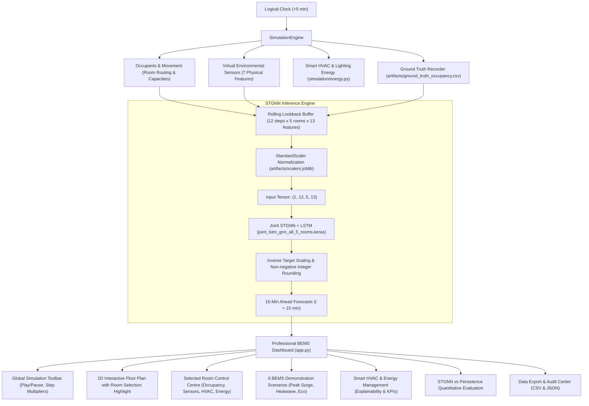

# AI-Based Five-Room Occupancy Digital Twin & Building Energy Management System (BEMS)

An end-to-end discrete-time Digital Twin for multi-room building occupancy simulation, virtual environmental telemetry, real-time smart HVAC & lighting energy management, and 15-minute predictive forecasting using an improved Spatio-Temporal Graph Neural Network (STGNN) + LSTM architecture.

---

## 1. System Architecture



---

## 2. Requirements & Environment Setup

This project uses Python 3.11 with TensorFlow / Keras 3, Streamlit, Plotly, pandas, and scikit-learn.

### Dependencies
All core dependencies are pre-installed in the project environment:
- `streamlit` (v1.64.0)
- `plotly` (v7.1.0)
- `tensorflow` (v2.20.0)
- `keras` (v3.12.0)
- `pandas` (v2.3.0)
- `numpy` (v2.2.0)
- `scikit-learn` (v1.6.0)
- `joblib` (v1.5.0)
- `pytest` (v9.1.0)

*(No additional external packages or paid APIs are required).*

---

## 3. Quick Start Commands (Windows PowerShell)

Open Windows PowerShell in the project directory:

```powershell
cd d:\VIT\SEMS\SEMESTER_7\PJT1\Digital_Twin
```

### A. Run the Interactive BEMS Control Centre Dashboard
```powershell
streamlit run app.py
```
*The dashboard will automatically open in your default browser at `http://localhost:8501`.*

### B. Run the Automated Test Suite (All 190 Tests across 14 Suites)
```powershell
python -m pytest tests/
```
*Runs all 190 tests covering simulation engine (14), sensor engine (10), STGNN pipeline (9), dashboard (7), interactive population & sensors (16), manual people flow (11), manual movement HVAC coupling (6), sensor physics (15), smart HVAC & energy management (20), BEMS interactivity & usability (11), Phase 8.1 interactive floor plan & overlays (11), Phase 8.2 / 8.3 animated occupant movement, 60 FPS canvas visualizer, visual replay & inspector (36), Phase 8.5 UI redesign (8), and Phase 9 Advanced HVAC Digital Twin (8).*

### C. Run the Headless 8-Hour Simulation Demo
```powershell
python run_simulation_demo.py
```

### D. Generate Full Phase Verification Reports
```powershell
# Phase 2 Parity Check:
python verify_parity_cell62.py

# Phase 3.2 Sensor Calibration & Audit:
python generate_sensor_report.py

# Phase 3.3 End-to-End Inference & Metrics Report:
python generate_inference_report.py
```

---

## 4. Professional BEMS Dashboard Workspaces

The interactive dashboard (`app.py`) provides an industrial IoT control-room aesthetic with dedicated operational workspaces:

### 1. Global Simulation Control Toolbar
- **Play / Pause**: Smooth continuous auto-stepping with selectable speed (0.5s, 1.0s, 2.0s, 3.0s per step).
- **Configurable Step Duration**: Advance by 5 min (1 tick), 15 min (3 ticks — 1 STGNN Horizon), 30 min (6 ticks), or 60 min (12 ticks — 1 STGNN Lookback Window).
- **Logical Simulation Clock**: Formatted UTC clock, discrete step number, and real-time building occupancy.
- **System Indicators**: Clear status badges distinguishing Simulated Multi-Physics from STGNN Neural Network Forecasts.
- **Safe Reset Dialog**: Native confirmation popup preventing accidental simulation resets.

### 2. Building Overview & Central 2D Floor Plan
- **Dual-Tab Floor Plan Interface**:
  - `🎮 Live 60 FPS Digital Twin`: Client-side, hardware-accelerated HTML5 Canvas component (`dashboard/live_canvas.py`) delivering continuous visual movement along doorway waypoints via browser `requestAnimationFrame`.
  - `📐 Plotly Blueprint View`: Interactive high-resolution vector architectural floor plan with room boundaries, exterior exits, doors, and status badges.
- **Client-Side Visual Playback Controls**:
  - **Play / Pause**: Instantly freeze or resume visual movement interpolation without affecting server simulation state.
  - **Speed Scaling**: Visual playback speeds ($0.5\times, 1.0\times, 1.5\times, 2.0\times$) strictly decoupled from the 5-minute logical clock.
  - **Scrubber Slider & Replay**: Inspect specific trajectory progress and replay recent movements.
  - **Instant Hover HUD Tooltips**: Zero-latency telemetry inspection for rooms and occupants directly on the canvas.
- **Adaptive Occupant Marker Sizing**:
  - Automatically scales marker diameter based on room population density: $10\text{px}$ ($<15$ occ), $8\text{px}$ ($15-30$ occ), and $6\text{px}$ ($>30$ occ) to eliminate visual occlusion under surge loads.
- **Comprehensive Occupant Inspector (`dashboard/occupant_inspector.py`)**:
  - Deep inspection of individual occupant state: ID, category/role, authoritative room vs real-time visual transit progress, intended destination, door-to-door waypoints, and entrance queue status.
  - Search by occupant ID substring, filter by room, and filter by status (`All Inside`, `Stationary`, `In Transit`, `Queued`).
  - Candidate summary table with one-click occupant selection and automatic cleanup of stale selections upon occupant departure.
- **Movement History & Visual Replay Center**:
  - Chronological movement ledger with filtering by room (synchronized with selected room), occupant ID, and event type (`admission`, `transfer`, `exit`).
  - Bounded memory retention ($\le 100$ events FIFO, $\le 25$ exit records).
  - Non-mutating visual replay (`▶ Replay`): triggers visual reenactment of historical door transitions while authoritative room populations, sensors, and kWh counters remain 100% untouched.
- **Active Room Highlight**: Selected room receives a high-contrast `#00F0FF` border (width 5) and `[SELECTED]` badge.
- **Multi-Physics Overlays**: 6 layers (Occupancy, Temperature, CO₂, Illuminance, HVAC Power, Total Power) with color threshold scales and rich legend banner.
- **Selected Room Control Centre**: Dedicated side panel consolidating Occupancy, Environmental multi-physics, HVAC setpoints, Daylight harvesting, and Physical Explainability for the focused room.
- **Synchronized Room Summary Cards**: 5 one-click cards below the floor plan updating the floor plan and control centre synchronously.
- **Contextual Workspace Navigation**: Quick navigation callouts directing operators to People Flow Control or Smart HVAC & Energy management with active room context preserved.

### 3. People Flow & Dispatch Operations
- **➕ Add People**: Entrance injection with real-time capacity and entrance queue preview.
- **🔄 Move Between Rooms**: Topological doorway route validation preventing invalid wall-walking, source occupant multiselect, batch size selection, and capacity headroom verification.
- **➖ Exit People**: Departure control by room or building-wide with queue and occupancy reconciliation.
- **📋 Diurnal Schedule Viewer**: Inspect active occupant circadian profiles and assigned home offices.

### 4. Live Environmental Sensor Telemetry
- **Signal Classification**: Clear distinction between Immediate Algebraic signals (Lux, Sound), Dynamic Integration (Temp, RH, CO₂), and Outdoor Weather Drivers (Dry-Bulb Temp, Outdoor RH).
- **Cross-Room Matrix**: Side-by-side comparative table with lamp states (`💡 ON` / `🌑 OFF`) and all 7 sensor values.
- **Historical Analysis & Statistics**: Time window filtering (Last 1 hour, 3 hours, 6 hours, All history) with Current, Min, Max, and Average summary statistics.
- **Physical Model Inspector**: Inspection of room volume, air exchange ACH, thermal capacitance, and noise floors.

### 5. Smart HVAC & Building Energy Management
- **Building Energy KPIs**: Total Power Demand ($kW$), HVAC Power ($kW$), Lighting Power ($kW$), Cumulative Energy ($kWh$), Rooms in Eco Mode, and Active Occupants.
- **Highest Consuming Room Callout**: Automatically isolates the highest consumer and details physical heat gain drivers (+100 W/occ sensible heat, thermal delta $T_{in} - T_{sp}$, daylight deficit).
- **Filterable & Sortable Room Table**: Filter by HVAC mode or room, and sort by Power, Energy, Occupancy, or Temperature.
- **Comparative Visualizations**: Power breakdown bar chart, cumulative kWh trends, occupancy vs power correlation, and smart vs baseline savings comparison.
- **Room Operational Controls**: HVAC mode overrides (`Auto`, `Eco`, `Force Off`), comfort setpoint sliders ($18.0\text{--}28.0^\circ\text{C}$), and lighting mode overrides (`Auto`, `Force On`, `Force Off`).

### 6. Predictive Evaluation & Benchmark Parity
- **Executive Summary**: Clear non-ML explanation of graph-neural spatial forecasting.
- **Real-Time Horizon Matrix**: Live comparison between ground truth and 15-minute STGNN forecasts.
- **Quantitative Benchmarks**: Integer MAE, Integer RMSE, and Persistence Baseline comparison.
- **Residual Error Plots**: Visual error traces over time relative to zero-error baseline.
- **Domain Generalization Notice**: Transparent explanation of mathematical parity vs synthetic physics domain differences.

### 7. Data Export & Audit Center
- One-click downloads with rich metadata cards (record count, time span, schema):
  - `ground_truth_occupancy.csv` (Physical Ground Truth)
  - `virtual_sensor_readings.csv` (First-Principles Physics)
  - `occupancy_predictions.csv` (STGNN Neural Network Inference)
  - `room_energy_consumption.csv` (Simulated Electrical Telemetry)
  - `evaluation_metrics.json` (Benchmark Metrics Summary)
- Live 25-row table previews for all datasets.

### 8. BEMS Demonstration Scenarios
Six reproducible presets accessible directly from the toolbar:
1. **Normal Workday** (40 occ, nominal schedules, 24.5°C setpoints)
2. **Low Occupancy** (15 occ, off-peak operation, vacancy setbacks)
3. **Peak Occupancy Surge** (80 occ, heavy metabolic & thermal loads)
4. **Empty Building** (0 occ, weekend/night operation, all rooms drop to ECO mode)
5. **Aggressive Energy Saving** (26.5°C setpoints, strict daylight harvesting, 35-45% energy reduction)
6. **Summer Heatwave Stress Test** (35.0°C outdoor ambient dry-bulb temperature)

---

## 5. Directory Structure

```text
Digital_Twin/
├── app.py                             # Clean BEMS command centre orchestrator (6 workspaces)
├── joint_lstm_gnn_all_5_rooms.keras   # Saved trained Keras STGNN model archive
├── notebook.ipynb                     # Original exploration & training notebook
├── reconstruct_scalers.py             # Reproducible preprocessing & scaler extraction
├── stgnn_model.py                     # Standalone STGNN inference engine (Keras 3)
├── verify_parity_cell62.py            # Exact numerical parity verification script
├── run_simulation_demo.py             # Headless workday simulation demonstration runner
├── generate_sensor_report.py          # Phase 3.2 sensor audit generator
├── generate_inference_report.py       # Phase 3.3 pipeline audit generator
├── artifacts/
│   ├── ground_truth_occupancy.csv     # Logged ground-truth occupancy
│   ├── virtual_sensor_readings.csv    # 7-feature synchronized sensor telemetry
│   ├── occupancy_predictions.csv      # 15-minute STGNN forecasts & backfilled actuals
│   ├── room_energy_consumption.csv    # Synchronized room power and cumulative kWh
│   └── scalers.joblib                 # Reconstructed 70% chronological training scalers
├── audit/
│   ├── phase1_audit.md                # Phase 1: Read-only workspace & notebook audit
│   ├── phase2_verification_report.md  # Phase 2: Numerical parity verification report
│   ├── phase3_sensor_report.md        # Phase 3.2: Sensor calibration & distribution report
│   ├── phase3_inference_report.md     # Phase 3.3: End-to-end inference evaluation report
│   ├── phase5_interactive_population_report.md # Phase 5: Interactive population & sensors
│   ├── manual_people_flow_report.md   # Manual People Flow Control audit report
│   ├── phase6_sensor_physics_report.md# Phase 6: Realistic sensor physics audit report
│   ├── phase7_energy_management_report.md # Phase 7: Smart HVAC & energy management report
│   ├── phase8_dashboard_usability_report.md # Phase 8: BEMS usability & interactivity report
│   ├── phase8_1_floorplan_report.md   # Phase 8.1: Interactive floor plan & overlays report
│   ├── phase8_2_occupant_animation_report.md # Phase 8.2: Occupant animation & movement visualization report
│   └── phase8_3_visualization_report.md # Phase 8.3: Live 60 FPS animation, replay & inspector report
├── config/
│   ├── building.json                  # 5-room spatial layout, dimensions, doors, capacities
│   ├── energy_parameters.json         # Physical HVAC/lighting ratings, setpoints, COP, baselines
│   └── sensor_parameters.json         # Physical constants, ACH rates, setpoints, noise std
├── dashboard/
│   ├── __init__.py                    # Dashboard module exports
│   ├── animation.py                   # Occupant movement animation layer & waypoint routing
│   ├── live_canvas.py                 # Live 60 FPS HTML5 Canvas component (requestAnimationFrame)
│   ├── occupant_inspector.py          # Real-time occupant telemetry, search & route inspector
│   ├── components.py                  # Theme CSS, Global Toolbar, Dialogs, Room cards
│   ├── floorplan.py                   # 2D floor plan with room highlight and status badges
│   ├── room_detail.py                 # Selected Room Control Centre panel
│   ├── overview.py                    # Building Overview workspace tab
│   ├── people_flow.py                 # People Flow Control workspace tab
│   ├── sensors_view.py                # Environmental Telemetry workspace tab
│   ├── energy_view.py                 # Smart HVAC & Energy Management workspace tab
│   ├── prediction_view.py             # Predictive Evaluation workspace tab
│   ├── exports_view.py                # Data Export & Audit Center workspace tab
│   ├── scenarios.py                   # 6 BEMS demonstration scenario definitions & application
│   ├── charts.py                      # Plotly time-series and comparative charts
│   └── state.py                       # Streamlit session state and execution controls
├── dataset/                           # Raw synchronized historical 5-room CSV datasets
│   ├── combined_Room1.csv
│   ├── combined_Room2.csv
│   ├── combined_Room3.csv
│   ├── combined_Room4.csv
│   └── combined_Room5.csv
├── simulation/
│   ├── __init__.py                    # Simulation package exports
│   ├── building.py                    # Building spatial entity, doors, route solver
│   ├── config.py                      # Building configuration schemas & validation
│   ├── energy.py                      # Smart HVAC & lighting controllers, baseline comparator
│   ├── engine.py                      # Discrete-time simulation engine & 5-min logical clock
│   ├── environment.py                 # Outdoor diurnal weather model (temperature, RH, sun)
│   ├── ground_truth.py                # Ground-truth occupancy logger & CSV exporter
│   ├── occupant.py                    # Occupant entity, decisions, spatial movement
│   ├── pipeline.py                    # End-to-end DigitalTwinPipeline connecting model & sim
│   ├── room.py                        # Room entity, doors, capacity enforcement
│   ├── schedules.py                   # Behavioral schedules (Regular, Visitor, Staff)
│   └── sensors.py                     # Physical environmental sensor models
└── tests/
    ├── conftest.py                    # Shared pytest fixtures
    ├── test_dashboard.py              # Phase 4: Dashboard visualizer & export tests (7 tests)
    ├── test_dashboard_bems.py         # Phase 8: BEMS interactivity & usability tests (11 tests)
    ├── test_phase8_1_floorplan.py     # Phase 8.1: Interactive floor plan & overlays (11 tests)
    ├── test_occupant_animation.py     # Phase 8.2 & 8.3: Occupant animation, canvas & replay tests (36 tests)
    ├── test_energy_management.py      # Phase 7: Smart HVAC & energy management (20 tests)
    ├── test_interactive_population.py # Phase 5: Interactive entry, queueing & sensors (16 tests)
    ├── test_manual_people_flow.py     # Manual People Flow Control tests (11 tests)
    ├── test_phase6_sensor_physics.py  # Phase 6: Sensor physics & thermodynamics (15 tests)
    ├── test_pipeline.py               # Phase 3.3: Pipeline, causality & horizon tests (9 tests)
    ├── test_sensors.py                # Phase 3.2: Virtual sensor engine tests (10 tests)
    └── test_simulation.py             # Phase 3.1: Virtual building & occupant tests (14 tests)
```

---

## 6. Implementation Parity vs. Simulation Domain Mismatch

1. **Exact Mathematical Parity**:
   The standalone inference implementation ([`stgnn_model.py`](file:///d:/VIT/SEMS/SEMESTER_7/PJT1/Digital_Twin/stgnn_model.py)) achieves exact bitwise parity ($\text{MAE} \le 1.78 \times 10^{-7}$) against the original training notebook on identical test samples.
2. **Domain Generalization**:
   The STGNN model was fitted on historical real-world academic building data. In the digital twin simulation, environmental telemetry is generated from first-principles physical equations (mass-balance CO₂, lumped capacitance thermal models, and logarithmic acoustics). Because 15-minute office occupancy exhibits strong short-term inertia during steady work periods, the Persistence Baseline ($\hat{y}_{t+15} = y_t$) achieves comparable MAE (1.55 vs 1.61 occupants). This disparity is documented and transparently highlighted in the dashboard.

---

## 7. Known Limitations & Simulation Assumptions

1. **2D Geometry**: The room coordinates and dimensions represent a configurable virtual demonstration facility matching the 5-node graph topology rather than an architectural blueprint of the original historical building.
2. **Deterministic Schedules**: Occupant behavioral routines (arrival, lunch in Room 5, meetings in Room 1/3, departures) are heuristic simulation models designed for reproducible testing.
3. **Causal Horizon**: The model requires 12 continuous 5-minute steps (60 minutes) to complete its warm-up buffer before producing valid forecasts.
4. **Virtual Utility Meters**: Electrical power draws and cumulative kWh represent simulated physical engineering approximations, not revenue-grade utility billing meters.
